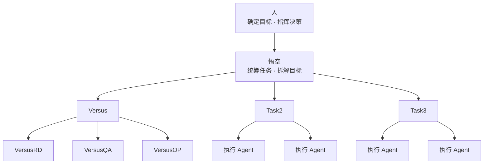

OpenMausBot 是一款针对 Grok Bot 的免费开源替代品，与 Grok Bot 不同的是：OpenMausBot 可以直接运行在我们本地的 Claude、Codex 或 Gemini 订阅上，无需额外的订阅。和 Grok Bot 一样，仅通过简单的聊天对话，我们就能在 IM 聊天界面中获得一整支 AI Bots 团队，每个 Bot 都有自己的模型、记忆和连接的应用。

<!--more-->

## 什么是 OpenMausBot？
2026 年 8 月，Milind Soni 在 GitHub 上发布了 Grok Bot 的开源实现 OpenMausBot，并以非常快的迭代速度进行发布。OpenMausBot 的 UI 看起来很像 Telegram、WhatsApp：侧边栏是联系人列表，只不过这里的每一个联系人都是一个 AI Agent。我们可以为每一个 Bot 赋予独特的个性、任务分工和运行模型。当我们发送一条消息时，AI Bot 便会执行任务，AI Bots 之间会以 IM 消息的方式来转发任务并进行 Handoff。

OpenMausBot 的 [Github 项目主页](https://github.com/milind-soni/OpenMausBot) 是这样描述自己的：
> Every bot in the sidebar is a real agent — Claude or Codex running locally under the hood — with its own personality, its own model, its own cloud computer, and its own connected apps. Talk to them like contacts. Watch them work.


正如上图所示，OpenMausBot 并不要求我们输入 API 密钥，而是直接调用机器上已经登录的 AI Agent。这非常方便！！！

想想我们在使用 OpenClaw、Hermes 之类的工具时，我们还需要额外配置 API 鉴权，虽然不复杂，但确实也麻烦。在 OpenMausBot 中，我们现有的订阅账号就是它的大脑，OpenMausBot 只是搭建了一套团队协作外壳，仅此而已。

## 为每个 Bot 配置独立的模型
在 Grok Bot 中，我们无法更换模型——xAI 给什么我们就只能用什么。而在 OpenMausBot 中，每个 Bot 都有独立的模型选择器。一个 Bot 可以运行 Claude，另一个 Bot 运行 Codex……每个聊天窗口右上角都有一个下拉菜单，供我们在不同的模型之间自由切换。

> Free software is free as in freedom, not free as in beer.

自由切换不同的模型非常重要，不同的工作需要不同的大脑。我的日常工作会涵盖不同的场景，整理文档、调研、编码……
- 对于文档整理而言，我会选择更擅长写作的模型，比如 Gemini 4 Argon
- 对于编码而言，我则会选择 Opus 5.5 这种 Coding 能力更强的模型
- 对于代码 Review 而言，我则会选择与 Claude 非同族的其他模型，例如 GPT-6
- ……


## 每个 Bot 都拥有专属的计算机环境
OpenMausBot 内部配备了一个电脑面板，每个 Bot 都会获得一个云端桌面（云端桌面是需要购买订阅的）——即一台运行在远程服务器上、由 Bot 自主控制的真实 Linux 电脑，并在机器人工作时提供实时的屏幕预览。我们可以观察 AI Bot 的点击操作、打开应用程序并完成任务，我们也可以在浏览器中打开该桌面接管控制。

实际上，我们可以将 AI Bot 直接指向自己的 Mac 电脑，以允许 OpenMausBot 在我们的真实物理机上展开工作。


## 本地优先架构
OpenMausBot 采用本地优先架构：一个运行在本地 Mac 电脑上的服务来管理 Agent 进程，所有 AI Bots 的对话记录、事件日志也都保存在电脑的本地文件夹中。需要明确的是，我们所调用的模型——Claude、Codex、Gemini 依然会将数据传输至云端处理。因此，OpenMausBot 是在云端托管大脑之外包裹了一层本地优先的基础设施。对我而言，这种轻巧的架构正式我所需要的。

## 使用 OpenMausBot 完成编码任务
SpaceXSI 的工程师 Lauren Tan 在 X 上发布了自己如何使用 Grok Bot 实现每月提交 2500 个 PR 的推文：_how i shipped 2,500 PRs last month to production_。



我把大模型评估平台的开发任务也迁移到了 OpenMausBot。我先让 OpenMausBot 把之前的 workspace 迁移过来，并对应的创建了 3 个 AI Bot。

```text
在 /Users/wangwei17/Documents/Project/versus 目录下，有一个 Cluade 的 workspace，是我们大模型评估平台的的项目目录。请帮我生成 3 个 Bot，一个是以 Cluade CLI 为基础（VersusRD），主要是开发、实现versus的需求并完成相关自测；一个是以 Codex CLI 为基础(VersusQA)，主要是对需求修改的代码进行代码的 Code Review 以及代码文档的一致性进行check；一个以 Claude CLI 为基础(VersusOP)，主要是在本地以非登录模型部署versus，同时VersusOP还负责对部署问题，日志等的排查和修复工作。
```


OpenMausBot 不但按照要求创建了 3 个 Bot，还自动为这三个 Bot 创建了部门，这一点确实体验非常好。对于不同的项目，我可以创建不同的部门，然后不同部门下由不同的 Bot 来完成对应的开发任务。



用 OpenMausBot 完成 [使用 OpenTelemetry 观测并优化 Agent](/2026/10/27/OpenTelemetry-in-Agent-Optimization/) 这篇文章中介绍的功能点：

> **需求指令**：`/teamwork-preview` 把 /leaderboard 页面的title 从“模型排行榜”改为“模型榜单”。

悟空开始处理任务，并通知 VersusRD 完成编码任务。


versusRD 收到悟空的消息，并按照原 Claude Workspace 的规范启动编码任务。


VersusOP 部署代码、启动服务，并在本地的浏览器中打开首页 URL。


悟空最后把最终的结论回复给我。


## 展望
随着 Grok Bot 的出圈，_Message Bots like teammates_ 的设计思路慢慢成为一种趋势，我们给 Bots 一个任务，然后看着他们自主的沟通、协同、一步一步的完成我们给定的任务……这种体验，比在 Codex、Claude 等 Agent 中输入任务，然后盯着那不断滚动的屏幕更有控制感。

Grok Bot、ChatGPT Dots、Claude Duet、OpenMausBot、Klex Bots、Rerun……类似的产品会越来越多……在 [Radar Scout](https://my-tierroom.party/explore) Agent 榜单，OpenMausBot 也受到更多用户的关注，暂列榜一。


在我的体验中，其实 OpenMausBot 也并没有非常完美，依然有很多可以改进的地方：
- 在 Versus Bots 完成开发任务时，各 Bots 完成任务后总是首先向 “悟空” 汇报，然后由 “悟空” 再调度其他 Bots，各 Bots 之间并没有进行必要的沟通。实际上，各 Bots 之间是可以通信的。也有可能是我调教的方式还不够完美，可能随着我的使用，OpenMausBot 会进化并学会这个技巧。
- Bot 在接受到 Message 任务后，点击对应 Bot 进入聊天窗口之后，并不会刷新并显示最新的任务消息，每次还需要点击一下“会话”才会显示最新的消息。
- 在 Claude Code 中，我配置了 OpenTelemetry 来上报 Traces 信息，但是 OpenMausBot 触发的 Claude Code Bots 在执行过程中，并没有将相关 Trace 信息上报。

好在 OpenMausBot 的迭代频率非常快，随着 OpenMausBot 的不断成长，这些问题应该也会不断得到解决。
