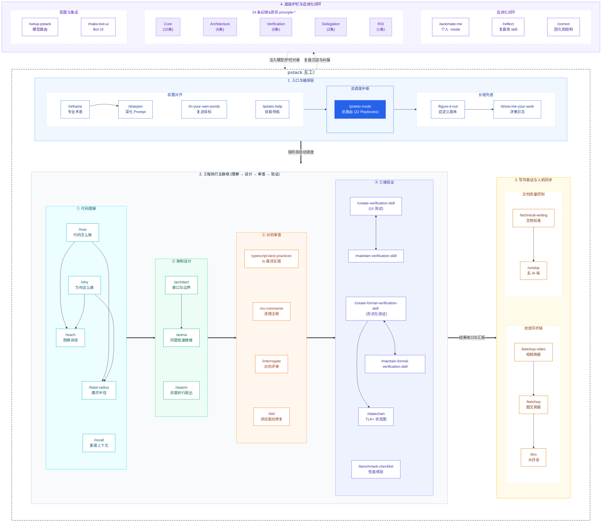
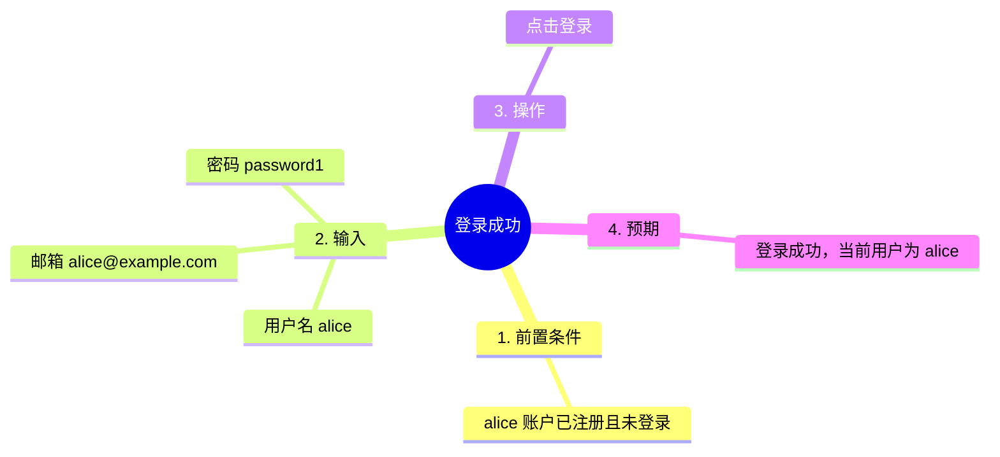
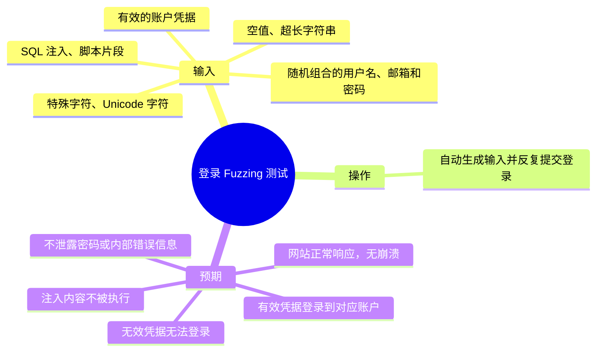
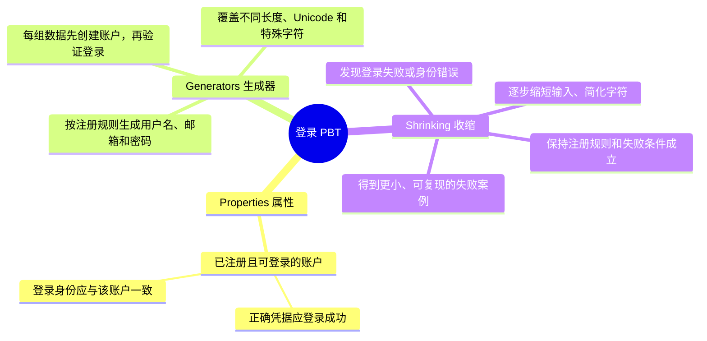

2026 年 11 月，Lauren Tan（@poteto）在 AIE 的分享 [All Code Is Slop (Except Mine)](https://www.youtube.com/watch?v=O_zcc6Xl12g) 中说到：我们真的正在进入软件测试和验证的黄金时代。

> Agent drastically cut this cost down. And really, we are entering a golden age of software testing and verification. Because agents let us test everything to a much greater degree than used to be economical.

这篇文章将以 pstack 为蓝图，分析、思考 AI Coding 时代的 Verify 体系构建思路。

<!--more-->
## pstack 概述
Lauren Tan（@poteto）在 _All Code Is Slop (Except Mine)_ 中的思考很大程度上来自 [pstack](https://github.com/cursor/plugins/tree/main/pstack) 的深度实践。作为 SpaceXSI Grok Bot 的负责人，Lauren Tan（@poteto）一手开发了 pstack 并收录在官方 cursor/plugins 仓库。

pstack 包含一整套打包好的 Skills、Playbooks、Subagents 和工程原则，其核心目标是对抗“AI slop”。所以， 与让 AI 上来就乱改、快速产一堆垃圾代码不同，pstack 贯彻 _If you want to go fast, go deep first_ 的理念，通过 `/pstack:architect`、`/pstack:blast-radius`、`/pstack:arena` 等 Skills 让 AI 写出更高质量、可验证的代码，正如 Lauren Tan 在 AIE 上的分享所说的那样：

> 软件工程师的工作，编程的目标，就是想办法在大幅提高生产力的同时，保持甚至提升代码的质量。

代码的质量贯穿从需求到上线的每一个细节，pstack 用一套规范的 Skill 体系对开发的全流程进行了严格的约束，核心思路主要是两点：
- _If you want to go fast, go deep first_, 如果你不了解它，你就不要动它。读一读 `/pstack:architect` 的定义就能体会到： 
```markdown
Before writing code, trace every system the change touches, then sketch two different shapes for it (types, signatures, module boundaries) and pick the one where each piece of state has one owner, each task has one way to do it, and callers need to know least. Redesign instead of patching if workarounds repeat.

For a large or contested design, run the **arena** skill instead of sketching alone.
```
- 实践是检验真理的唯一标准，任何结论和证据都要真的 _prove them by running code_。`/pstack:blast-radius` 中明确要求：
```markdown
## Don't trust your own writeup

A blast-radius writeup that sounds right is worthless. It reads as convincing whether or not it's true. So don't hand back the writeup. Find the one or two facts the whole thing depends on and prove them by running code.
```



无论是多高级的模型，都有可能存在幻觉。而 pstack 则把 _实践是检验真理的唯一标准_ 的哲学体现的淋漓尽致。在 pstack 中，所有的结论、证据都需要有切实的执行层面的证据，而不是仅停留在模型层面。

- 在 `architect` 中，有如下的描述：_For a large or contested design, run the **arena** skill instead of sketching alone._
- 在 `benchmark-checklist` 中，是这样描述的：_Answer each question with evidence from a run, not a guess about the code._
- 在 `blast-radius` 中，pstack 要求：_Find the one or two facts the whole thing depends on and prove them by running code._
- 在 `interrogate` 中，对于可能的风险，要求：_Adversaries try to break a change or a design. A finding survives only when a run proves it._
- 在 `poteto-mode` 中，为了避免模型幻觉，明确要求：_Cite only principles whose leaf SKILL.md you read this session._
- ……

## pstack coding 哲学
### 核心工程哲学
> 写多少、按什么顺序建、何时重来

| 原则名                            | 一句话描述                 | 核心要求                                                              |
| ------------------------------ | --------------------- | ----------------------------------------------------------------- |
| Laziness Protocol              | 能删不写，最小改动             | 把重复决策收拢到单一事实源；用最少代码解决问题，拒绝 “优雅的样板代码”。                             |
| Foundational Thinking          | 先定数据结构，再写逻辑           | 动代码前先定核心类型和访问路径；先搭基建（CI/测试）；并发共享状态必须先隔离，除非互不影响。                   |
| Redesign from First Principles | 从第一性原理 redesign，不硬打补丁 | 接新需求时问：“如果第一天就有这需求，会怎么设计？” 连同文档、示例一并穿透更新，再分步交付。                   |
| Attack the Premise             | 同一个前提连续失败两次，先怀疑前提     | 基于同一假设的两次修复都没通过时，立即停止；把假设写成一句话并设计实验直接证伪，停止在错误的假设下继续打补丁。           |
| Subtract Before You Add        | 先做减法，再做加法             | 任何重构/新增代码前先删掉死代码、多余校验和 dangling reference；只为观测到的真实用法设计，不为脑补边界写防御。 |
| Minimize Reader Load           | 把读者的心智负担压到最低          | 减少调用层级，缩小可变状态作用域。新人 30 秒内能回答出：“X 从哪来、谁能改 X”？                      |
| Outcome-Oriented Execution     | 直奔终态，不为中间态留兼容债        | 有明确阶段边界的重构/迁移中，允许有计划、可逆的短暂破坏，直接收敛到目标架构，不写一次性兼容代码。                 |
| Experience First               | 用户体验优先于               | 在代码实现和用户体验冲突时，优先选后者；宁可交付 3 个打磨精致的功能，也不要 10 个粗糙功能。                 |
| Exhaust the Design Space       | 无先例时，做多原型横向比选         | 面对全新 UI 交互或无先例架构决策（靠 “体感” 而非纯逻辑判断），先做 2~3 个竞争原型并排对比再拍板。           |
| Build the Lever                | 非平凡任务先造工具，不靠手搓        | 除极少数简单修改外，先实现 1 个样本再写脚本/codemod/校验器并复跑验证；diff 里没产出工具文件等于没用此原则。    |

### 架构设计哲学
> 状态、边界、类型与并发

| 原则名                                      | 一句话描述            | 核心要求                                                                   |
| ---------------------------------------- | ---------------- | ---------------------------------------------------------------------- |
| Model the Domain                         | 用结构建模，消灭 if/else | 用状态机、注册表、Reducer 替代跨文件散落的条件分支和成对布尔值（但简单局部逻辑不过度抽象）。                     |
| Boundary Discipline                      | 校验守在系统边界，内部信任类型  | CLI/配置/网络/外部 API 入口一次性校验并解析为领域类型；内部不做重复判空，核心业务逻辑写成无框架依赖的纯函数。           |
| Type System Discipline                   | 让非法状态在类型上不可表示    | 用编译器兜底：语义不同的基础类型用 Brand 区分、外部数据必经边界解析、穷尽枚举分支、直接从权威 Schema 推导类型。        |
| Make Operations Idempotent               | 所有写操作必须幂等、可重入    | 基于 “当前实存状态 vs 目标状态” 做差量收敛；用 “写临时文件 + 原子重命名” 确保任意点崩溃重启后都能识别脏现场并恢复。      |
| Migrate Callers Then Delete Legacy APIs  | 先升级调用方再删除旧 API   | 内部 API 升级且无外部兼容包袱时，一次性升级调用方、删掉旧接口和旧细节测试，不留兼容过渡层。                       |
| Separate Before Serializing Shared State | 并发先解耦消除共享，不得已才加锁 | 默认给每个并发执行者独立文件/目录/分支，读时再合并（两人改同一 state.json 不同字段仍算共享写入）；听到 “需要加锁” 先警惕。 |

### Verify 哲学
> 什么才是好的测试、什么才是真修复

| 原则名                                 | 一句话描述            | 核心要求                                                                                              |
| ----------------------------------- | ---------------- | ------------------------------------------------------------------------------------------------- |
| Prove It Works                      | 用真实产物证明，不信 “能编译” | 亲自跑功能、读实际值、看 diff，拒绝 Agent 的非执行信号（时间戳/缓存/口头自称）；能写成确定性复现脚本就不靠肉眼看一次。                                |
| Fix Root Causes                     | 追到第一个出错点，不靠兜底掩盖  | 先复现再追问 “触发症状的状态是否合法”：非法状态靠加判断/吞错误/重试只是掩盖 bug，要追到源头并清查同类模式。                                        |
| Sequence Work into Verifiable Units | 拆成步步可验的小单元递进交付   | 多步改造/PR，按 “已知良好 → 单步改动 → 验证变绿” 推进；提交顺序自证逻辑（先失败测试再修复、先减法再重构）。                                      |
| Test Behavior, Not Implementation   | 测试外部可观测行为，不锁内部实现 | 两项假想检验：①故意弄坏外部行为，测试必须挂；②重写内部实现但保持输出不变，测试必须依然全绿。                                                   |
| Explain the Number                  | 先解释瓶颈与噪声，再相信跑分   | 跑 benchmark 前先定决策阈值；必须回答 “为什么不能快一倍？”（拿出 profile 瓶颈证据），排除缓存/报错/未执行等假加速（配合 `/benchmark-checklist`）。 |

### 委派与自治哲学
> Agent 协作与异步推进

| 原则名                      | 一句话描述            | 核心要求                                                                  |
| ------------------------ | ---------------- | --------------------------------------------------------------------- |
| Guard the Context Window | 守住主线程上下文，重活丢给子代理 | 大文件读取、冗长日志、批量扇出全交给子代理，主线程只留精炼摘要；按阶段限制文件数与轮次预算，防止上下文膨胀降智。              |
| Never Block on the Human | 可逆操作直接干，不可逆才停下问  | 写代码/拆任务等可逆工作直接推进并汇报结果，别问 “要不要做 X”；仅 force-push、删生产数据、对外发消息等不可逆动作暂停确认。 |

### RSI 哲学
> 系统如何越用越聪明

| 原则名                         | 一句话描述             | 核心要求                                                                    |
| --------------------------- | ----------------- | ----------------------------------------------------------------------- |
| Encode Lessons in Structure | 重复提醒两次的规则，固化进工程结构 | 发现同一句话说了两遍，别再加文档，直接写成 Lint、类型约束、运行时检查或脚本；能用结构兜底，就只用结构修复（对应 `/correct`）。 |

## Verify 术语

### Example-based 测试
在传统的测试（`example-based testing`）中，针对每一条测试 case，我们都会给定一个具体的、明确的输入。假设我们正在测试一个网站的登录页面，并且想要测试用户是否可以使用用户名、邮箱和密码登录该网站。

传统的测试会为每个字段构建硬编码的字符串：



如果要覆盖中文用户名、带特殊字符的密码、超长输入等各种编码情况，就需要继续增加对应的测试 case。这种方式的优点是简单、直接，确实也同样明显，也是我们目前正面临着的困境：
- **容易遗漏边界情况**：RD&QA 可能没有考虑到某种 Unicode 字符或特殊输入组合，导致测试分支遗漏。
- **测试 case 爆炸**：用户名、邮箱和密码的组合类型会产生大量测试 case，随着功能的不断叠加，测试 case 数量不断爆炸。

如上的问题对于客户端的测试更为明显：对于页面 X 的功能 Y，有多个入口、多个操作序列可以触达，传统的测试方法就要求穷举所有的可能，无论在测试 case 维护还是执行方面，都面临非常严峻的挑战。

### Fuzzing 测试
Fuzzing 测试与 Property-based 测试很像，Fuzzing 测试通常会生成大量的输入组合来避免边界遗漏。

但是，Fuzzing 不是完全随机地生成输入，而是覆盖率导向生成输入：跟踪每个输入覆盖的代码，并基于新的覆盖路径继续构建输入。Fuzzing 测试常用于测试别人的软件（测试者对软件的内部细节了解较少），因此 Fuzzing 测试的目标更多是通用的属性故障，例如崩溃、安全问题……如果 Fuzzing 测试器发现了 bug，_我们更多的是报告 bug 而不是自己修复 bug_。

在网站登录的例子中，Fuzzing 测试器可能会同时发送无效数据和有效数据，并检查网站在响应请求时是否会崩溃或出现不安全的行为。



### Property-based 测试
在 Property-based 测试（_PBT_）中，我们不再像传统的 example-baded 测试那样手动编写几个特定的输入输出测试 case，而是先定义“系统必须永远满足的通用规律（性质/不变式）”，再由测试框架自动生成海量的 _随机输入_ 并试图证伪这些不变式。

同样的，我们以网站登录的例子来解释 Property-based 测试。在 Property-based 测试中，我们首先定义通用性质（_property_）——例如，任意合法邮箱+非空密码都能成功认证，且密码永远不能以明文出现在日志中——测试框架会自动塞入各种极端字符串、特殊 Unicode、超长边界或随机操作序列去猛撞系统，并挖掘出我们想不到的边界 bug。



Property-based 测试通常由三个核心部分构成：
1. Properties（性质/不变式），常见模式包括：
    - Safety Always：永不发生错误的事情，例如：不崩溃、不丢数据、不破坏状态约束
    - Liveness Sometimes：期望状态最终一定会发生，例如：节点恢复、消息确认
    - 逻辑性质：例如：往返一致性（decode(encode(x)) = x）、幂等性（f(f(x)) = f(x)）
2. Generators（生成器）：开发者用代码描述合法输入的 “形状” 和分布（数据结构、领域对象、操作序列等），框架据此自动探索输入空间。
3. Shrinking（收缩）：一旦某个随机输入撞出了 bug，框架会自动剥离无关部分，将其化简为最小可复现反例，直接帮我们干掉一半的调试工作。

!!! note "不同 PBT 工具的差异"
    传统 PBT 工具（例如，QuickCheck、Hypothesis 以及 Antithesis 开源的 Hegel/Bombadil）主要测试函数、库或 UI，而 Antithesis 平台把 PBT 扩展到整个分布式系统——在确定性仿真环境里把网络分区、宕机、并发调度等都作为随机输入空间，检验系统级的 Always/Sometimes 性质并支持确定性回放。

PBT 与 Fuzzing 测试的差异：

| 对比维度   | Property-based Testing                        | Fuzzing 测试                                          |
| ------ | --------------------------------------------- | --------------------------------------------------- |
| 历史渊源   | 源自函数式编程社区，Haskell QuickCheck……                | 源自安全与系统编程社区，AFL、LibFuzzer……                         |
| 核心目标   | 关注高层次功能与业务逻辑正确性，依赖开发者显式写出业务不变式（Properties）来评判 | 主要关注安全性与底层稳定性，默认评判标准是 “程序不能崩溃、不能卡死、不能触发内存越界”        |
| 输入怎么生成 | 结构先验驱动：开发者熟悉业务，显式描述合法数据的类型，能深入复杂的业务状态         | 覆盖率驱动：常把输入看作原始字节流或弱结构数据，靠代码插桩监控覆盖率，自动变异出能走到新代码分支的输入 |
| 可读性    | 语义级 Shrinking，直接吐出最小、人类易读的操作序列                | 产出导致崩溃的原始字节数据，偏底层数据而非高阶业务语义                         |

!!! note "趋势观察"
    目前，PBT 与 Fuzzing 测试的边界正越来越模糊，Fuzzing 测试也引入了结构感知和业务断言，PBT 也吸收了覆盖率引导。像 Antithesis 这样的全系统确定性仿真测试，本质上就是把 Fuzzing 测试的探索与故障注入能力和 PBT 的高阶属性断言融合成了一套体系。

### `TLA+`
`TLA+`（Temporal Logic of Actions，动作时序逻辑）是由图灵奖得主 Leslie Lamport（LaTeX、Paxos、Mutex 等作者）设计的一套重点面向并发与分布式系统的形式化规格语言体系，配合模型检验工具，在编码前把系统逻辑“跑一遍数学上的所有可能”，从而在设计阶段就能够发现隐蔽的正确性缺陷。

`TLA+` 不是编程语言，而是一套“数学规格说明书”语言：先把系统应该怎么做、状态怎么流转写成严密模型，再用工具穷举所有可能的执行路径，并验证会不会出现死锁、丢消息、重复执行、状态不一致等问题。`TLA+` 描述“应该是什么”，不负责“怎么高效写”。

| 层次              | 含义                                                                       |
| --------------- | ------------------------------------------------------------------------ |
| TLA             | 在一阶谓词逻辑上扩展的时序逻辑：<br />用动作（Action）描述“状态如何从一个变到下一个”，用时序算子描述“未来/不变/终将发生”等性质 |
| +（PlusCal/TLA+） | 包含规约语言、规范写法（模块、变量、不变式、进程）和配套工具链                                          |
| 模型检验            | 给定有限的状态空间（如进程数、消息条数），工具自动遍历所有状态组合，检查是否违反了规约                              |

```horizontal
`TLA+` 特别适合发现如下的问题：
- 死锁
- 竞态条件、数据竞争
- 消息丢失、重复、乱序
- 分布式一致性缺陷（脑裂、重复提交）
- 边界条件遗漏、极端交错执行路径

---
`TLA+` 特别适合如下的场景：
- 分布式协议、共识算法
- 并发流程、锁与同步机制
- 金融交易、状态机等“逻辑正确性优先” 的核心设计
- 架构评审阶段对齐各方对系统行为的理解

---
`TLA+` 不适用于如下的场景：
- 直接替代实现语言
- 验证代码性能、吞吐量、延迟等非功能指标
- 状态空间无限大时需要人工加边界，工具不能证明一切
```

### `SMT 验证器`
`SMT 验证器`（MT-based verifier）是一类基于 SMT（Satisfiability Modulo Theories，可满足性模理论）求解器，是用于自动判定“一个逻辑公式是否有解”的形式化验证工具。在程序与协议验证中，`SMT 验证器` 用来证明：给定输入满足前置条件时，代码/规约永远不会违反安全性质，或者找出一个违反性质的具体反例。

| 维度           | TLA+（模型检测器）                                                            | SMT 验证器（如 Z3 / Kani / CBMC 等）                    |
| ------------ | ---------------------------------------------------------------------- | ------------------------------------------------ |
| 核心回答         | 事件有没有可能以糟糕的顺序发生？                                                       | 对所有可能输入，这段代码本身是否始终成立？                            |
| 适用场景         | 并发竞态、重试重叠、锁 / 租约过期、分布式协议、状态机流转、死锁                                      | 内存安全、数组越界、整数溢出、解析器边界                             |
| 验证对象         | 针对设计抽离出的小型抽象模型                                                         | 直接跑在真实源代码上                                       |
| 底层方式         | 状态空间搜索（穷举状态转移路径）                                                       | 约束求解（把程序逻辑与断言转为公式，搜寻反例输入）                        |
| pstack 的内建深度 | 一等公民：设为默认工具，并专门内置了 `/statechart` 技能，把 TLA+ 模型直接转成 Mermaid 状态图并标出最短违规路径 | 按需接入：不绑定特定 SMT 工具，由 Agent 视仓库语言和团队可安装成本挑选最合适的验证器 |

### Formal Verification
正如 `pstack:create-formal-verification-skill` 中的描述那样，与其他的测试方法不同：形式化测试校验的是规定范围内的每一种情况——模型里的每一种步骤顺序、界限内的每一个输入，甚至所有可能的输入。

> A test checks the cases that someone thought to write. Formal verification checks every case in a stated scope: every order of steps in a model, every input up to a bound, or every input.

形式化测试不是“跑我们能够想到的测试 case 碰碰运气”，而是利用数学逻辑与自动化推理引擎，对设定范围内的所有可能执行路径或输入做穷举并证明：
- 如果条件成立 → 给出该范围内绝无反例的确定性结论
- 如果条件不成立 → 直接吐出一条严格可复现的反例路径

在 pstack 中，按成本由低到高对应 3 类形式化验证工具：
1. 模型检测（默认 TLA+）：对业务的核心部分做状态空间穷举，查并发与事件时序，并配合 `/statechart` 把反例画成最短路径状态图。
2. 源码级有界验证（SMT 验证器，如 Kani/CBMC/Z3 等）：把真实代码路径转为逻辑约束，查界限内的所有输入。
3. 定理证明助手（如 Lean/Coq）：当有界范围都不够、必须证明不变式在任意范围下恒成立时使用。

传统测试、PBT、Fuzzing 测试等测试手段本质上都是 _抽样证伪_，只能证明 bug 存在，不能证明 bug 不存在，而 PBT、Fuzzing 测试则把抽样的广度和智能度做到了极致。形式化验证不是 _抽样逻辑_，而是在限定边界内做 _穷举证实_，把限定空间中的每一种合法排列组合一个不漏地全部覆盖。

如前所述，形式化测试非常适用于如下的场景：
- 并发与分布式时序难题
- 复杂状态机流转
- 底层安全与极端数值边界
- ……

## pstack 中的 Verify 体系
Lauren Tan（@poteto）在 [All Code Is Slop (Except Mine)](https://www.youtube.com/watch?v=O_zcc6Xl12g) 中分享了 pstack 中的五层 Verify 质量体系，这个质量体系也可以视作 AI Coding 时代的 Verify 质量体系范本。


在 Poteto Pyramid 的 5 层防线中，越往上边际成本越低、ROI 却越高。AI 时代，在测试思路上，我们总想不断往 AGENTS、Skills、Rules 等文件中增加 Prose 文本规则（例如 AICR、团队 rules 规约……），我们会认为用这种方式来取代 _human review_ 就是用 AI 提升效率了。然而，恰恰相反，文本规则的成本也是巨大的，只比 _human review_ 好一点点而已。

就像 `pstack:principle-encode-lessons-in-structure` 中写的那样：

```markdown
If the lesson needs judgment and cannot be encoded, make the instruction more prominent and add an example of the failure mode.

**Corollary:** If the fix is structural, only use the structural fix. The instruction is the symptom.
```

从中我们也能发现 pstack 的 Verify 设计思路：
1. 好的 codebase 才能产出高质量的后续代码，_打扫干净屋子再带客_
2. 用上层的静态分析、运行时/形式化验证，把更多的错误挡在人类接手之前，用更低的边界成本获得最大的 ROI
3. 把信任建立在 _可执行、可证伪的现实反馈_，而不是模型的口头承诺，实践是检验真理的唯一标准，用运行时执行作为反馈信号

!!! note "思考"
    pstack 的 Verify 体系，本质上是把 Verify 方式从廉价易忘的 Prompt 和昂贵的人工 Review，系统性地迁移到了版本依赖、强静态分析、运行时验证、形式化验证等持续向上固化的 looping 反馈闭环之上。


## pstack 实践
AI Coding Agent 常见的问题就是：虚假汇报，改完代码、跑通编译和单元测试就宣布任务完成。但编译通过、单测全绿并不等同于用户视角功能正常。`create-verification-skill` 是一个 Meta Skill，强制为项目沉淀一套脚本化、可重复、面向 Agent 的真实应用驱动与取证方案，把 _Prove It Works_ 沉淀为仓库、组织资产。

手动执行 `/pstack:create-verification-skill` 生成 versus 平台的 e2e skill `verify-versus`。

```horizontal

---

```

`verify-versus` 执行结果：
```horizontal

---

```
